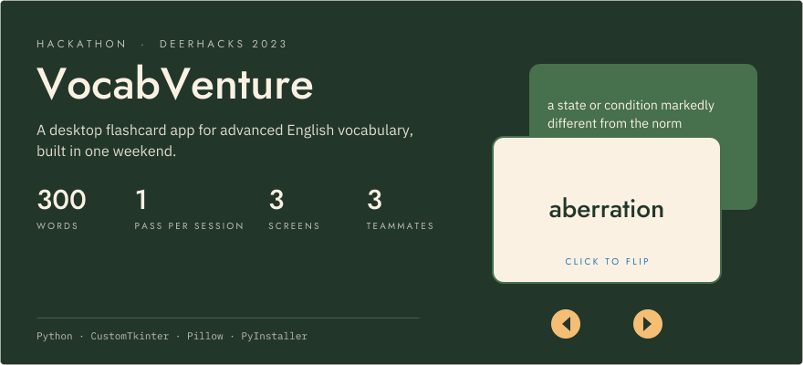
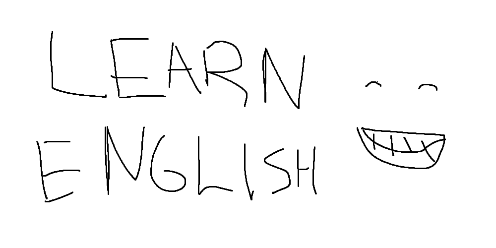
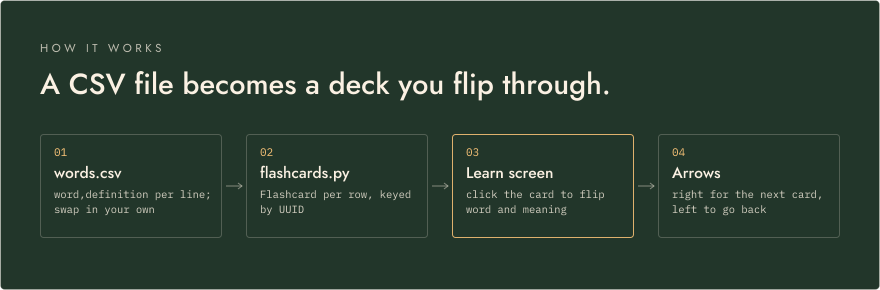
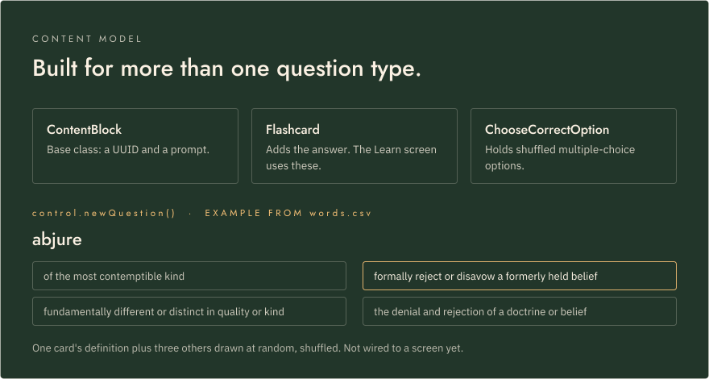

<p align="center">
  <picture>
    <source media="(prefers-color-scheme: dark)" srcset="assets/readme/hero-dark.svg">
    <source media="(prefers-color-scheme: light)" srcset="assets/readme/hero-light.svg">
    
  </picture>
</p>

<p align="center">
  <strong>Learn 300 advanced English words with flip cards, on a deck you can swap for your own.</strong><br>
  <strong>Flip cards &middot; one pass per session &middot; a CSV word list</strong><br>
  <sub>Built in one weekend at DeerHacks 2023 with Python and CustomTkinter, by Haashir Khan, Shishir Aravindan and Moses Luna.</sub>
</p>

<p align="center">
  
  
  
</p>

<!-- TODO: demo link or video -->

<p align="center">
  
</p>

---

VocabVenture loads a deck of 300 advanced English words with short definitions and walks you through them as flashcards. Click a card to flip between the word and its meaning, then move on. The app also has a How To screen with illustrated instructions, and a custom-drawn interface with image buttons.

## How it works

<p align="center">
  <picture>
    <source media="(prefers-color-scheme: dark)" srcset="assets/readme/how-it-works-dark.svg">
    <source media="(prefers-color-scheme: light)" srcset="assets/readme/how-it-works-light.svg">
    
  </picture>
</p>

`words.csv` holds one `word,definition` pair per line and is loaded at startup, so you can swap in your own list. Every card in the deck is shown once per session, in order, before the deck runs out. `GUI.py` builds each screen (main menu, Learn and How To) as a frame and swaps frames in and out of one 800×600 window.

## Content model

<p align="center">
  <picture>
    <source media="(prefers-color-scheme: dark)" srcset="assets/readme/content-model-dark.svg">
    <source media="(prefers-color-scheme: light)" srcset="assets/readme/content-model-light.svg">
    
  </picture>
</p>

`flashcards.py` is the data model. Flashcards and multiple-choice items share the `ContentBlock` base, so new question formats can reuse the same storage and lookup. Cards are kept in a dictionary keyed by ID, plus an ordered list of IDs for stepping through the deck.

`control.py` sits between the GUI and the model. `newQuestion()` builds a multiple-choice question from one card's definition and three other cards' definitions, picked without repeats and shuffled. Because the distractors come from the rest of the deck, it works with any word list and needs no hand-written wrong answers. It isn't connected to a screen yet.

## Getting started

On Windows, run the prebuilt app:

```
dist\gameApp\gameApp.exe
```

From source (Python 3.10 or later, because the code uses `list[str]` type hints):

```sh
pip install customtkinter pillow
python gameApp.py
```

Run it from the repo root, since it loads `images/` and `words.csv` by relative path. Some image names in `GUI.py` differ in case from the files (for example `images/quit.png` and `Quit.png`), so the source version only runs on a case-insensitive file system such as Windows or default macOS.

## Team

Built at DeerHacks 2023 by Haashir Khan, Shishir Aravindan and Moses Luna.
