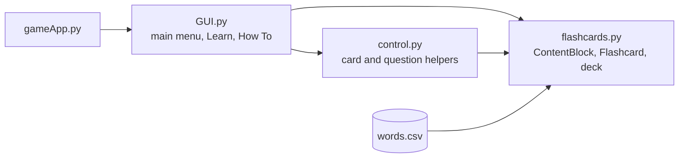

# VocabVenture

A desktop flashcard app for learning advanced English vocabulary, built in one weekend at the DeerHacks 2023 hackathon.


## Demo

<!-- TODO: demo link or video -->


## Overview

VocabVenture loads a deck of 300 advanced English words with short definitions and walks you through them as flashcards. Click a card to flip between the word and its meaning, then move on to the next one. The deck is a plain CSV file, so you can swap in your own word list.

## Key features

- A Learn mode with flip cards: click a card to toggle between the word and its definition, use the right arrow for the next card, and the left arrow to go back.
- Every card in the deck is shown once per session, in order, before the deck runs out.
- A How To screen with illustrated instructions.
- A custom-drawn interface with image buttons, built on CustomTkinter.
- A word list loaded from `words.csv` (`word,definition` per line) at startup.
- A Windows build made with PyInstaller in `dist/gameApp/`.

## Tech stack

| Area | Tools |
|---|---|
| Language | Python 3.11 |
| GUI | Tkinter, CustomTkinter, Pillow |
| Data | CSV |
| Packaging | PyInstaller |

## Architecture



- `flashcards.py` is the data model. `ContentBlock` is a base class with a UUID and a prompt. `Flashcard` adds an answer, and `ChooseCorrectOption` holds shuffled multiple-choice options. Cards are kept in a dictionary keyed by ID, plus an ordered list of IDs for stepping through the deck.
- `control.py` sits between the GUI and the model. `newQuestion()` builds a multiple-choice question from one card's definition and three other cards' definitions, picked without repeats and shuffled.
- `GUI.py` builds each screen as a frame and swaps frames in and out of one 800×600 window.

## Technical highlights

- The content model is built for more than one card type. Flashcards and multiple-choice items share the `ContentBlock` base, so new question formats can reuse the same storage and lookup.
- The multiple-choice generator in `control.py` draws distractors at random from the rest of the deck, so it works with any word list and needs no hand-written wrong answers. It isn't connected to a screen yet.

## Getting started

On Windows, run the prebuilt app:

```
dist\gameApp\gameApp.exe
```

From source (Python 3.10 or later, because the code uses `list[str]` type hints):

```sh
pip install customtkinter pillow
python gameApp.py
```

Run it from the repo root, since it loads `images/` and `words.csv` by relative path. Some image names in `GUI.py` differ in case from the files (for example `images/quit.png` and `Quit.png`), so the source version only runs on a case-insensitive file system such as Windows or default macOS.

## Team

Built at DeerHacks 2023 by Haashir Khan, Shishir Aravindan and Moses Luna.
